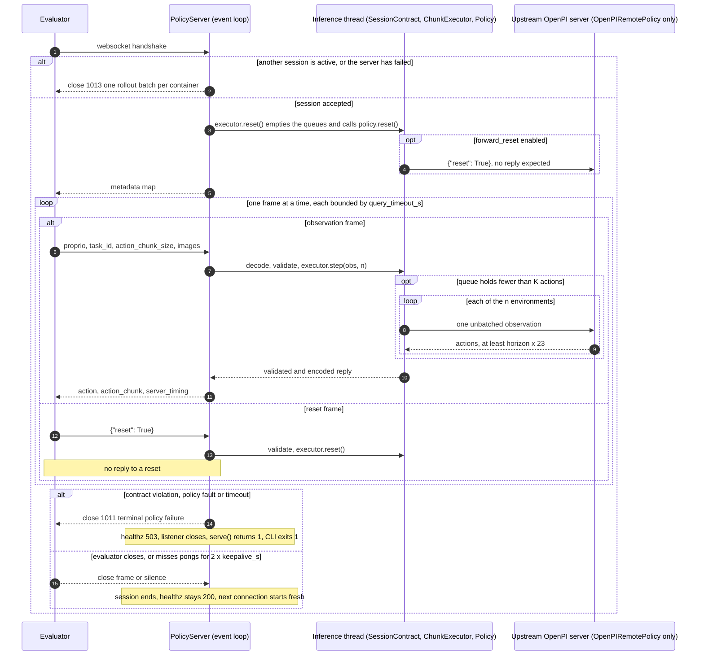

# Serving contract

`policybank.serving` sits between the challenge evaluator and one routed policy during hidden
evaluation. It speaks the BEHAVIOR / OpenPI websocket protocol, checks every inbound frame and every
outbound action against a strict contract, executes the policy's native action plan in fixed transport
chunks, and fails closed: any policy-side fault ends the session with close code 1011 and stops the
server.

| Module | Role |
|---|---|
| `codec` | bounded msgpack + numpy wire format (`pack`, `unpack`, `MAX_BYTES`) |
| `contract` | `ContractSpec` (limits), `SessionContract` (per-connection validation), `ContractError`, `CHUNK_KEY` |
| `executor` | `Policy` protocol, `ChunkExecutor` (receding-horizon execution in chunks), `ScriptedPolicy` |
| `server` | `PolicyServer` (the fail-stop websocket server and its health endpoints), `PolicyFault`, `QueryTimeout` |
| `remote` | `OpenPIRemotePolicy`: a `Policy` backed by an OpenPI-compatible checkpoint server; `UpstreamError` |
| `client` | `PolicyClient`: a minimal synchronous client for smoke tests |

Signatures are in [api.md](api.md#policybankserving). The container image, its 10-check smoke test and
the CI workflow are described in [`docker/README.md`](../docker/README.md).

## Deployment model

- **One image per routed policy, one container per task.** The first observation binds the task id. A
  later observation with a different task id is a contract violation, also on a new connection,
  because the binding belongs to the server, not to the session. `PolicyServer(task_id=...)` binds it
  up front; the CLI does not.
- **One evaluator session at a time.** A second concurrent connection is closed with 1013. One frame
  carries a batch of 1–10 environments.
- **Every session starts from a reset policy.** When a connection is accepted, the server runs
  `ChunkExecutor.reset()` (empty action queues, then `policy.reset()`) on the inference thread, bounded
  by `query_timeout_s`, before it sends anything.

## Wire format

Every frame is a binary websocket message holding one msgpack map (`codec.pack` / `codec.unpack`).
Numpy values are encoded as marker maps, compatible with the OpenPI `msgpack_numpy` client:

| Value | Encoding |
|---|---|
| `np.ndarray` (including 0-d) | `{"__ndarray__": True, "data": <raw bytes, C order>, "dtype": <dtype.str, e.g. "<f4">, "shape": [...]}` |
| numpy scalar | `{"__npgeneric__": True, "data": <Python scalar>, "dtype": <dtype.str>}` |

The encoder writes the marker keys as byte strings (`b"__ndarray__"`, `b"__npgeneric__"`, as OpenPI
does); the decoder accepts byte or text keys. A 0-d array decodes as a 0-d array, not as a scalar.
`np.float64` scalars subclass `float`, so msgpack sends them as plain floats and they decode as Python
floats. Decoded arrays are read-only views of the frame. Encoding an array or scalar whose dtype is not
bool, integer or float (object, string, complex, ...) raises `TypeError`.

Decoding is bounded. It raises an error, instead of allocating, for:

- frames larger than `MAX_BYTES` (128 MiB) and frames that are not `bytes` or `bytearray`;
- dtypes other than bool, signed or unsigned integer and float (`"biuf"`), item sizes above 8 bytes,
  and dtype strings longer than 8 characters;
- shapes that are not a list, have more than 8 dimensions, or have negative or non-integer entries;
- arrays larger than `MAX_BYTES`, and `data` whose byte length is not the shape times the item size;
- marker maps missing one of their fields, and an `__ndarray__` marker whose value is not `True`;
- scalar markers carrying a list, map or bytes payload, or a payload that numpy cannot convert to the
  dtype or that overflows it;
- msgpack extension types, arrays with more than 1,000,000 items and maps with more than 100,000 keys.

These errors are `ValueError`, except that a dtype string numpy cannot parse raises numpy's
`TypeError`. Inside the server every decoding error becomes a `ContractError` ("undecodable frame").

## Session

On connect the server sends one metadata map:

| Key | Value |
|---|---|
| `protocol` | `"b1k-2026"` |
| `policy` | the policy's `name` (CLI `--policy`) |
| `action_dim` | `ContractSpec.action_dim` (23) |
| `max_batch` | `ContractSpec.max_batch` (10) |
| `action_chunk_size` | the global chunk K, `ContractSpec.chunk` (CLI `--chunk`, default 4) |
| `replay` | the policy's `horizon`, its native replay length (CLI `--replay`) |
| `failure_mode` | `"terminal"` |

After that the evaluator sends observation frames and reset frames, one at a time.

### Observation frame

| Key | Requirement |
|---|---|
| exactly one string key ending in `proprio` (for example `robot_r1::proprio`) | shape `(61,)` for one unbatched environment, or `(N, 61)` with 1 ≤ N ≤ 10; integer or float dtype; all values finite |
| `task_id` | required; integer dtype, 1 or N elements, all equal, in 0–99 (`ContractSpec.tasks`); must equal the bound task |
| `action_chunk_size` (`CHUNK_KEY`) | one integer element equal to K when K > 1. With chunking disabled (K ≤ 1) it must be 0 or 1, or absent |
| anything else (camera images, ...) | not checked |

The whole decoded map, including the keys above, is passed to `Policy.plan`.

The batch shape `(N, batched)` is fixed by the first observation after connect or after a reset.
Unbatched `(61,)` and batched `(1, 61)` are different shapes. A different shape without a reset in
between is a violation.

### Reply

| Key | Shape | Meaning |
|---|---|---|
| `action` | `(23,)` or `(N, 23)`, float | the action to execute now |
| `action_chunk` | `(K, 23)` or `(N, K, 23)`, same dtype as `action` | the next K actions of the current plan; row 0 equals `action` byte for byte. Present only when K > 1 |
| `server_timing` | map | `{"total_ms": <float>}`: time from receiving the frame to building the validated reply, before encoding and sending |

The server checks every outbound action too. A wrong shape, a non-float dtype, a nonfinite value, a
missing or malformed chunk (wrong shape, dtype different from `action`, nonfinite), a chunk whose row 0
differs from `action`, or a chunk while chunking is disabled is a `ContractError`, which is terminal.

### Reset

A reset frame is exactly `{"reset": True}`; any frame that has a `reset` key and is not exactly that is
a violation. The server sends **no reply**. It clears the batch-shape binding (the next observation may
use a new batch shape), empties the action queues and calls `policy.reset()` before the next action is
produced. The task binding is kept. More than 1,000 resets
(`ContractSpec.max_resets_between_queries`) without an answered observation in between is a violation.

## Chunking: why K must divide the replay length

Each policy in the bank plans a fixed horizon natively and replays it before planning again: 32
actions for the Comet family, 20 for the winner family and the winner-format specialists. The
evaluator asks every server for one global chunk size K per query.

`ChunkExecutor` keeps one queue of planned actions per environment. Each query returns the next K
actions from the queue, and the policy is asked for a new plan only when the queue holds fewer than K
actions. If K divides the replay length, the queue empties exactly at the end of each native plan: the
server plans at the same control steps as the native policy and executes every planned action once,
so the chunked action stream is identical to the native receding-horizon stream. If K did not divide
it, the last `replay mod K` actions of every plan would be dropped and the policy would re-plan early.

K = 4 divides both 32 and 20. `ChunkExecutor` raises `ValueError` at construction when K > 1 does not
divide the policy's `horizon`. `PolicyServer` builds its executor in `__init__`, so
`python -m policybank serve --replay 20 --chunk 8` exits with that error before it listens. K ≤ 1
disables chunking: one action per query and no `action_chunk` in the reply.

`Policy.plan` must return shape `(n, H, action_dim)` with `H >= horizon`, all finite; the executor keeps
the first `horizon` actions. A plan with the wrong number of environments, too few actions, the wrong
width or a nonfinite value raises `ValueError` in the executor, which is a terminal `PolicyFault`.

## Failures

### Terminal failures (close code 1011)

Every exception raised while serving a session is terminal, except the evaluator's own connection
closing (see [Peer disconnects](#peer-disconnects)). The kinds are:

- **`ContractError`** (logged as kind `contract`): an undecodable or non-binary frame, a missing or
  duplicate `*proprio`, a wrong shape or batch size, nonfinite proprio, a missing, mixed or
  out-of-range `task_id`, a task change, a batch-shape change without a reset, a wrong chunk size, a
  malformed reset, too many resets, or an invalid outbound action or chunk.
- **`PolicyFault`**: any other exception raised on the inference thread, wrapped with its type and
  message. This covers model errors, a malformed or nonfinite plan, `UpstreamError` from
  `OpenPIRemotePolicy`, and a `ConnectionClosed` or `OSError` from the connection between the adapter
  and an upstream checkpoint server. Because of the wrapping, an upstream disconnect is never mistaken
  for the evaluator hanging up.
- **`QueryTimeout`**: one bounded step took longer than `query_timeout_s` (550 s by default, below the
  challenge's 600 s per-query limit). The bounded steps are the session reset on connect, the metadata
  send, and each frame (decoding, validation, inference, encoding and sending the reply; for a reset
  frame, the reset). The message is `session reset exceeded 550 s`, `metadata send exceeded 550 s` or
  `query exceeded 550 s`. The wait for the evaluator's next frame is not bounded; keepalive pings
  cover a vanished evaluator.

On a terminal failure the server:

1. logs `terminal failure: <kind> [<session id>]: <message>` at ERROR, where `<kind>` is `contract` or
   the exception's class name (`PolicyFault`, `QueryTimeout`, ...), and from then on answers
   `/healthz` and `/readyz` with 503;
2. closes the connection with code **1011**, reason `terminal policy failure` (waiting at most 1 s for
   the close handshake);
3. stops listening, and `serve()` returns 1. The command-line entry point then exits with
   `os._exit(1)`.

There is no retry, no substitute action, no fallback checkpoint and no automatic restart: a fabricated
action could turn a fault into a result that looks valid.

### Refused connections (close code 1013)

A connection that arrives while another session is active, or after a terminal failure but before the
listener has closed, completes the websocket handshake and is then closed with code **1013**, reason
`one rollout batch per container`, before any metadata is sent. The active session is not affected.

### Peer disconnects

If the evaluator closes its connection, the session ends. This is not a policy failure: `/healthz`
stays 200, the task binding is kept, and the next connection starts a new session from a reset policy.
A clean close (code 1000 or 1001) ends the session without a message from `policybank`; an abnormal
close is logged at WARNING as `session <id> closed by peer (...)`. A query that is running when the
evaluator leaves finishes (within `query_timeout_s`), and the failed send ends the session.

A peer that vanishes without closing (a dropped network, a killed process whose socket stays
half-open) is detected by websocket keepalive pings. Every `keepalive_s` seconds (default 30) the
server pings; if no pong arrives within twice that (60 s), the connection is dropped and the session
ends the same way. Without this the stale session would stay active, and the evaluator's reconnect
would be refused with 1013. The evaluator's websocket client must answer pings; standard websocket
client libraries do so automatically. `PolicyServer(keepalive_s=None)` disables the pings; the CLI
always uses 30 s.

## Timeouts and the inference thread

Each `serve()` call creates one dedicated inference thread (`ThreadPoolExecutor(max_workers=1)`, thread
name prefix `policy`). Everything that touches the policy runs on it: decoding and validating the
frame, `ChunkExecutor.step` and `Policy.plan`, `ChunkExecutor.reset` and `Policy.reset`, validating
the outbound action, and encoding the reply. Policy calls are therefore serialized, and the event loop
stays free to answer health checks, run keepalive pings and enforce timeouts.

Python cannot interrupt a hung model. When a step times out, the server fails and stops, but the
inference thread may still be running. `serve()` does not join it (`shutdown(wait=False,
cancel_futures=True)`), and the CLI exits with `os._exit` after `serve()` returns, so a hung thread
cannot keep the process or container alive. Code that embeds `PolicyServer` in its own process must do
the same.

Other limits:

| Component | Limit |
|---|---|
| `PolicyServer` websocket | compression off, 128 MiB message limit, incoming queue of one message, keepalive ping every `keepalive_s` (30 s) with a pong timeout of `2 * keepalive_s` (60 s), 1 s close timeout |
| `OpenPIRemotePolicy` | `timeout_s = 540` s for opening the upstream connection, for the upstream metadata and for each upstream reply; no message size limit; compression off |
| `PolicyClient` | `timeout = 30` s for opening the connection, for the metadata and for each reply; 128 MiB message limit |

SIGTERM and SIGINT stop the server cleanly where the event loop supports signal handlers (not on
Windows); `serve()` then returns 0 if no failure occurred, and so does the CLI.

## Health endpoints

Plain HTTP `GET /healthz` and `GET /readyz` on the websocket port return `200` with body `OK` while the
server is healthy, and `503` with body `FAILED` after a terminal failure. The two paths are identical.
Once the listener has closed after a failure, the port refuses connections. Any other path is handled
as a websocket handshake.

## Plugging in a real checkpoint

### The `Policy` protocol

Anything with these members can be served:

```python
class Policy(Protocol):
    name: str
    horizon: int        # actions replayed per plan (the native receding horizon)
    action_dim: int     # 23 for the R1Pro

    def plan(self, obs: dict, n: int) -> np.ndarray: ...   # (n, >= horizon, action_dim), finite
    def reset(self) -> None: ...
```

`plan` receives the decoded observation map (all keys, including images; arrays are read-only) and the
number of environments `n`, and returns one plan per environment. It is called only when the queue is
short of K actions. `reset` is called at the start of every session and for every reset frame.

To serve it from Python:

```python
import asyncio
import logging
import os

from policybank.serving.contract import ContractSpec
from policybank.serving.server import PolicyServer

server = PolicyServer(MyPolicy(), ContractSpec(chunk=4), query_timeout_s=550.0)
code = asyncio.run(server.serve("0.0.0.0", 8000))
logging.shutdown()
os._exit(code)          # do not wait for a possibly hung inference thread
```

`spec` defaults to `ContractSpec(action_dim=policy.action_dim)`. An explicit `ContractSpec` keeps its
own `action_dim` (23 by default), so it must match the policy's.

### OpenPI-compatible policy servers

OpenPI's `serve_policy.py` and the Comet and 2025-winner forks send a metadata map on connect and
answer each single-environment observation with a map whose `"actions"` entry holds the native plan
`(horizon, action_dim)`; a text reply signals an error. `OpenPIRemotePolicy` turns such a server into
a `Policy`, so the native preprocessing stays untouched:

- It opens one connection at construction and stores the upstream metadata in `metadata`. An
  unreachable upstream fails at startup: the CLI exits with the connection error before it listens.
- A query is sent as `n` sequential single-environment requests. The query counts as batched when the
  first `*proprio` array is 2-D, so a batched query with N = 1 is split too and the upstream always
  sees an unbatched `(61,)` proprio. In a batched query every array whose first dimension is `n` is
  indexed per environment. `task_id` is indexed the same way in an unbatched query, so a length-1
  `task_id` reaches the upstream as a scalar; a `task_id` of any other length, or a scalar, is sent
  unchanged. Keys in `drop_keys` (default `("action_chunk_size",)`) are removed; other values are sent
  as they are.
- Each reply must be a map with an `"actions"` entry that converts to a float32 array of shape
  `(H, action_dim)` with `H >= horizon`; the first `horizon` rows are kept and `plan` returns
  `(n, horizon, action_dim)` float32. A text reply, a reply without `"actions"`, a plan with the wrong
  shape, a closed upstream connection, an `OSError`, or no reply within `timeout_s` raises
  `UpstreamError`. A reply that does not decode raises the codec's error. Either way the server turns
  it into a terminal `PolicyFault`. Finiteness is checked by the executor.
- `reset()` sends nothing by default: the executor clears the wrapper's action queues, which is enough
  for stateless OpenPI servers. With `forward_reset=True` (CLI `--forward-reset`) it sends
  `{"reset": True}` upstream and reads no reply, at the start of every session and for every reset
  frame, for native BEHAVIOR servers that keep per-episode state. An upstream server that keeps
  per-episode state and does not accept the reset frame must be restarted for every session.

### Command line

```bash
# the checkpoint's own OpenPI server listens on 8001
python -m policybank serve --upstream ws://localhost:8001 --policy pt50 --replay 32 --chunk 4 --port 8000
```

| Flag | Default | Meaning |
|---|---|---|
| `--upstream URI` | none: serve `ScriptedPolicy` | `ws://` URI of an OpenPI-compatible policy server |
| `--forward-reset` | off | forward `{reset: True}` to the upstream server (for stateful native BEHAVIOR servers) |
| `--policy NAME` | `scripted` | policy name in the metadata and the logs |
| `--replay N` | 32 | the policy's `horizon`: 32 for Comet, 20 for winner-format models |
| `--chunk K` | 4 | the global chunk K (`ContractSpec.chunk`); must divide `--replay` when > 1 |
| `--host HOST` | `127.0.0.1` | bind address (the container passes `0.0.0.0`) |
| `--port PORT` | 8000 | port for websocket and health requests |
| `--query-timeout S` | 550.0 | `query_timeout_s` |

The CLI uses `ContractSpec(chunk=--chunk)`, so every other limit is the default: 61-dimensional
proprio, 23-dimensional actions, batches up to 10, tasks 0–99, at most 1,000 resets between answered
observations. It
keeps the 30 s keepalive and does not pre-bind a task. It logs at INFO
(`<time> <LEVEL> <message>`), including `SERVER_READY policy=... chunk=... replay=... port=...` once it
listens and the `websockets` library's own connection messages. Without `--upstream` it serves the
deterministic `ScriptedPolicy`, whose action at step `s` of plan `j` (counted since the last reset) is
`j + s / horizon` in every dimension and every environment; it is for protocol tests only.

Exit status: 1 after a terminal failure, 0 after SIGTERM or SIGINT without a failure, and a Python
traceback with a nonzero status for startup errors (an unreachable upstream, a chunk that does not
divide the replay, a port in use).

## Sequence



## Client example

`PolicyClient` is a small synchronous client for smoke tests. `infer(proprio, task_id, **extra)` sends
`robot_r1::proprio` as float32, `task_id` as an int64 array with one entry per environment (one entry
for an unbatched query), `action_chunk_size` as a 0-d int64 array holding the client's `chunk`, and any
`extra` keys; it returns the decoded reply. `reset()` sends `{"reset": True}` and reads nothing.

Start a server in one shell:

```bash
python -m policybank serve --host 127.0.0.1 --port 8000
```

and run this in another:

```python
import numpy as np

from policybank.serving.client import PolicyClient

with PolicyClient("ws://127.0.0.1:8000", chunk=4, timeout=30.0) as c:
    print(c.metadata)
    out = c.infer(np.zeros((2, 61), np.float32), task_id=69)   # a batch of two environments
    print(sorted(out), out["action"].shape, out["action_chunk"].shape)
    c.reset()                                                    # no reply is sent or read
    out = c.infer(np.zeros(61, np.float32), task_id=69)          # new batch shape, allowed after a reset
    print(out["action"].shape, out["action_chunk"][:, 0])
```

Output (scripted policy, replay 32; after the reset the plan restarts at 0):

```text
{'protocol': 'b1k-2026', 'policy': 'scripted', 'action_dim': 23, 'max_batch': 10, 'action_chunk_size': 4, 'replay': 32, 'failure_mode': 'terminal'}
['action', 'action_chunk', 'server_timing'] (2, 23) (2, 4, 23)
(23,) [0.      0.03125 0.0625  0.09375]
```

The clean close at the end of the `with` block is not a failure; the server keeps running and
`/healthz` stays 200. A task change is terminal:

```python
import numpy as np
import websockets

from policybank.serving.client import PolicyClient

with PolicyClient("ws://127.0.0.1:8000") as c:
    c.infer(np.zeros(61, np.float32), task_id=69)
    try:
        c.infer(np.zeros(61, np.float32), task_id=70)            # a task change is terminal
    except websockets.ConnectionClosedError as e:
        print(e.rcvd.code, e.rcvd.reason)
```

```text
1011 terminal policy failure
```

The server logs the failure, closes and exits with status 1:

```text
... ERROR terminal failure: contract [<session id>]: one task per container; a task change needs a new container
... INFO server closing
... INFO connection closed
... INFO server closed
```

## Container and smoke test

[`docker/README.md`](../docker/README.md) covers `docker/Dockerfile.serve` (a non-root image running
`python -m policybank serve` under `tini`), how to front a real checkpoint from a container, exit
codes, and `docker/smoke_test.py`, which runs 10 protocol checks against a fresh scripted server and
stops it with a final contract violation. `.github/workflows/serve-smoke.yml` runs the smoke test in
two jobs: against the server started from source, and against the built container image.

## What is and is not tested

- `tests/test_serving.py`: codec round trip, object dtypes, byte-length mismatches and text marker keys;
  the task and batch-shape bindings, rejected frames and outbound action checks; chunked-stream
  equality with the native stream for replay 32 and 20, and executor reset; and, against an in-process
  server, batches and resets, batch rows keeping their own environment, a fresh plan for every new
  session, 1013 for a second session while the first keeps working, 1011 on a contract violation, on
  nonfinite output, on a model exception (with `/healthz` turning red) and on a hung model (the query
  timeout), an abrupt peer disconnect that is not a failure, and keepalive pings dropping a silent peer.
- `tests/test_hardening.py` and `tests/test_properties.py`: a scalar marker cannot smuggle an array;
  randomized codec round trips (including 0-d arrays and scalars), random and corrupted frames failing
  only with `ValueError` or `TypeError`, out-of-range scalars, size caps; chunked streams equal to the
  native per-environment plans for random horizons, divisors and batch sizes.
- `tests/test_simulate_remote.py`: `OpenPIRemotePolicy` against a fake OpenPI server (batch splitting,
  truncation to the replay length, an upstream text reply as a terminal failure through the server,
  reset forwarding only when enabled).
- `tests/test_cli_process.py`: `python -m policybank serve` in a real subprocess, answering a batch,
  then failing on a task change with 1011 and exiting nonzero without hanging; and a clean shutdown
  on terminate (exit code 0 asserted on POSIX only).
- `docker/smoke_test.py`: the protocol checks against a running server or container.

Not verified in this release: full Isaac Sim 5.1 episodes at the required frame rate on the
organizers' hardware, and the native checkpoint images themselves (they are not part of the release).
